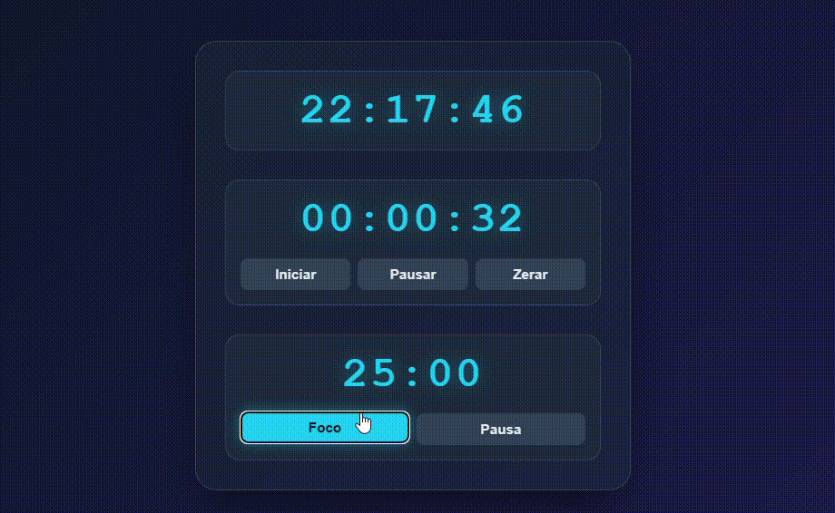

# Relógio Digital + Cronômetro + Pomodoro

Projeto de estudo que reúne três funcionalidades de tempo em uma única página web.

## Demo ao vivo

[Acesse o app](https://github.com/rikrdopires/Projeto-3---Cronometro.git)

## Funcionalidades

- **Relógio Digital** — exibe a hora atual em tempo real, atualizada a cada segundo
- **Cronômetro** — inicia, pausa e zera com precisão de segundos
- **Pomodoro** — técnica de foco com ciclos de 25 min (foco) e 5 min (pausa), com alerta sonoro e troca automática de modo

## Tecnologias

- HTML5 (semântico)
- CSS3 (variáveis, Flexbox, media queries)
- JavaScript (DOM, `Date`, `setInterval`, `clearInterval`, Web Audio API)

## O que aprendi e pratiquei

- Manipulação de DOM com `getElementById`
- Uso de `setInterval` e `clearInterval` para timers
- Formatação de tempo com `padStart`
- Controle de estado com variáveis
- Geração de som sem arquivos externos (Web Audio API)
- Convenções de nomenclatura (camelCase, UPPER_SNAKE_CASE)
- CSS com variáveis (`:root`) e organização por seções
- Responsividade com `@media`

## Preview
 

## Como rodar

Basta abrir o `index.html` no navegador. Não há build, não há dependências.

## 📂 Estrutura
relogio-cronometro-pomodoro/
├── index.html
├── preview.gif
├── style.css
├── script.js
└── README.md

## Autor
Feito por **Ricardo Ribeiro** como parte do meu portfólio de estudos em ADS.
